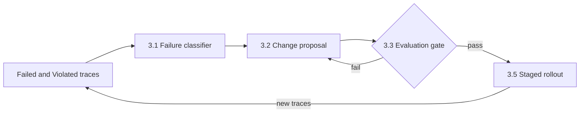
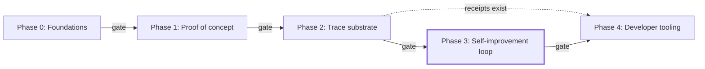

# DeterminAgent Program of Work — Baseline v1.0

Nov 18, 2026 · @Joel

> **Amendment 1 (Nov 24, 2026): a JavaScript domain, J2 first.** Joel decided to add JavaScript as a third domain, inside Phase 0 and before the 0.7 freeze. It is delivered in two tranches. Tranche 1 is J2 Generate with the execution sandbox (new workstream 0.8). Tranche 2 is J1 Advise and J3 Correct. The input and output contracts for all three are frozen with v1 now. TypeScript and frameworks are out of the POC. The JS checker is JavaScript-only, called from Python and exempt from the parity test. Joel labels. The changes are marked "Amendment 1" below, and the estimate is in [JavaScript domain](#javascript-domain-amendment-1).

## Purpose and design principles

DeterminAgent routes structured requests to narrow, specialized small language models (SLMs) using deterministic logic, and improves itself from its own execution traces. This program delivers it in five phases, each closed by a measurable exit gate.

- **Constrain input at the edge.** User intent is captured in a strongly typed schema before processing begins. Free text is the exception, not the default.
- **Deterministic at runtime, optimized offline.** Every routing decision is reproducible and explainable. Learning happens offline from traces and ships as versioned configuration.
- **Routing is a tunable policy.** Reflex, lookup, pattern rules and an LLM fallback are tiers. Their order, thresholds and rule set are parameters under optimization.
- **Nothing ships unmeasured.** Every change, whether code, prompt, rule or routing config, passes the same evaluation gate.
- **Every node leaves a receipt.** Each node transition emits a structured, tamper-evident record.
- **Build the loop before the lens.** The automated improvement loop comes before visual developer tooling.

## Success criteria and program metrics

The program succeeds when routing is accurate, cheap and fully deterministic, and when failures turn into shipped, verified fixes without manual debugging. The targets below are starting proposals for the two POC tasks; Phase 0 recalibrates them once baselines are measured.

Two reference points anchor them. First, typed input should make routing nearly a lookup, so routing tolerates no regression. Second, every golden-set run also goes through a general-purpose LLM as a comparison baseline, which makes the cost and quality case explicit.

| Metric | Definition | Initial target | Regression tolerance |
| --- | --- | --- | --- |
| Routing accuracy | Share of golden-set requests sent to the expected task and SLM | ≥ 99% | None; any drop fails the gate |
| Output well-formedness | Gherkin parses with the official parser; a RuleSpeak statement matches an approved sentence template | 100% after validator retry; ≥ 95% on first pass | None on final; −2 points on first pass |
| Task success rate | Ends Resolved and passes acceptance checks or the scoring rubric | ≥ 85% at POC exit; ≥ 90% at Phase 3 exit | −1 point |
| Validation precision / recall | RuleSpeak validation: share of flagged defects that are real / share of real defects flagged | ≥ 90% / ≥ 85% | −2 points each |
| Violation rate | Share of requests ending Violated | ≤ 1% | Any increase fails the gate |
| Quality vs. LLM baseline | Task success compared with the general-purpose LLM on the same cases | Within 5 points | Not gated; tracked |
| Cost per request | Model and compute spend, relative to the LLM baseline | ≤ 20% of baseline | +10% |
| Routing latency (p95) | Time spent in validation and routing, excluding the model | ≤ 50 ms | +10% |
| End-to-end latency (p95) | Validated input to validated output | Set from the Phase 0 baseline | +10% |
| Fallback rate | Share of requests handled by the LLM fallback tier (Phase 3 on) | ≤ 10% at Phase 3 entry, falling each cycle | +2 points |
| Time to remediate | New failure class appearing to a verified fix in production | Set after the first Phase 3 cycles | Tracked |
| Shipped regressions | Changes that passed the gate but degraded a metric in production | 0 | Each one triggers a gate review |

Tolerances of 1 to 2 points only mean something with enough cases. Start with at least 300 cases per task, grow toward 1,000 from production traces, and compare candidates with a paired test on the same cases.

## Phase 0: Foundations

Phase 0 produces the yardstick and the contracts everything else is built against: a golden evaluation set for RuleSpeak and Gherkin, baseline metrics, a fine-tuning readiness verdict, the intake pattern and frozen v1 schemas.

- **0.1 Domain specification.** The POC covers two domains and three tasks:
  - **RuleSpeak generation:** business intent in, conformant rule statements out.
  - **RuleSpeak validation:** rule statements in, conformance verdict and defects out.
  - **Gherkin requirements:** user requirement in, a feature with Given/When/Then scenarios out.
  - **JavaScript generation (J2, Amendment 1, tranche 1):** a typed function spec in, an ES module that exports the function out. It is accepted if it parses, is lint-clean under the JS profile and passes the case's hidden tests in the sandbox.
  - **JavaScript advise (J1) and correct (J3), tranche 2:** code in, findings out (J1); code and a failure signal in, a corrected module out (J3).

  Formalize each grammar: the approved RuleSpeak sentence templates and keywords, and the official Gherkin grammar. Much of the checking can then be deterministic (parser and template match), leaving the SLM only the semantic work.
- **0.2 Golden evaluation set.** For each task, a versioned set of labelled cases: typed input, expected route, and expected output or an acceptance rubric. RuleSpeak validation cases carry labelled defects. Include edge cases and adversarial inputs, and a held-out split that is never used for tuning.
- **0.3 Baselines and targets.** Measure every metric on the golden set, both for candidate SLMs and for the general-purpose LLM baseline, then confirm or adjust the initial targets.
- **0.4 SLM strategy (off-the-shelf first).** Evaluate off-the-shelf candidates for each task, with prompt optimization, against the golden set. A task moves to fine-tuning only if it misses its targets after prompt work.
- **0.5 Fine-tuning readiness assessment.** Answers whether fine-tuning is feasible if needed, before it is needed. It inventories:
  - **Data:** enough labelled pairs per task from the golden set, expert-written examples and validated synthetic data.
  - **Compute:** GPU access for parameter-efficient fine-tuning (LoRA or QLoRA) of a small model.
  - **Skills:** someone who can run training, evaluation and hyperparameter work.
  - **Serving:** hosting for adapter-based or fully fine-tuned models.

  Output: a ready / not-ready verdict per resource, the gaps, and the LOE to close them.
- **0.6 Intake UX design sprint.** A time-boxed sprint that picks the intake pattern:
  1. Map who writes rules and requirements, and what they start from.
  2. Sketch three concepts: a typed form, a template-guided editor (pick a RuleSpeak template or fill Given/When/Then slots) and a node canvas.
  3. Prototype the two strongest as clickable mock-ups.
  4. Test with target users on real tasks. Measure completion, time taken, free-text leakage and schema rejection rate.
  5. Choose the pattern, then the UI stack.
- **0.7 Contracts.** Freeze the typed input schema and the output schemas for each task, plus the handoff schemas for downstream tools and governance registers. Orchestration starts synchronous behind an interface, so a durable workflow engine can be added later without touching nodes.
- **0.8 Execution sandbox (Amendment 1).** An isolated runner for model-written JavaScript. It has no network, file system or child processes, enforces CPU, memory and time limits, and uses a fixed clock and seed. It captures parse, lint and per-test results in the `js_execution` contract. Any escape attempt fails the gate.

**Exit gate:** golden set v1 exists for the POC domains (with J2 under Amendment 1), the 0.8 sandbox runs J2 cases deterministically, baselines are measured and targets set, an off-the-shelf model is selected per task (or flagged for fine-tuning), the fine-tuning readiness verdict is in, the intake pattern is chosen, and the input and output schemas are frozen at v1.

## Phase 1: Proof of concept

The POC proves that constrained input can be routed to the right SLM, with no LLM in the routing path, at the accuracy targets set in Phase 0.

- **1.1 Input formalization.** A middleware parser turns structured intake into the typed request object, validated against the JSON Schema and an AST check. Malformed input is rejected with a typed reason code.
- **1.2 Tiered routing engine.** The router is a cascade, tried cheapest first:
  1. **Reflex:** exact or cached matches return immediately.
  2. **Lookup:** typed fields map directly to a domain.
  3. **Pattern rules:** regex and if-then rules handle partial structure.

  The tier order, thresholds and rules live in versioned configuration, not code. In the POC, input no tier matches ends Rejected with a reason code. The LLM fallback tier arrives in Phase 3.
- **1.3 Parameter-bound execution.** Strict, parameter-bound system prompts are written for each POC domain. A templating engine injects the typed payload, and each output is validated against its downstream contract.
- **1.4 Pipeline orchestrator.** It moves each request through validation, routing, SLM execution and output validation, synchronously, behind an orchestration interface. A durable workflow engine can replace it later without changing any node.

**Exit gate:** routing accuracy and task success on the golden set meet their Phase 0 targets, the routing path makes zero LLM calls, and p95 latency and cost per request are recorded.

## Phase 2: Trace substrate

Phase 2 makes every execution observable and verifiable, so that failures become structured learning data rather than log archaeology.

- **2.1 Trace interceptor.** Middleware wraps each node and captures the node id, hashes of its input and output, state mutations, latency, the routing tier and rule that fired, and the exit status.
- **2.2 Exit status taxonomy.** Every node ends in one of three statuses, each documented with examples:
  - **Resolved:** completed and passed output validation.
  - **Rejected:** refused by a validator or the router, with a reason code.
  - **Violated:** completed, but broke a contract or policy.
- **2.3 Execution receipts.** One receipt is emitted per node transition, mirroring the capsule's AST structure. Receipts go to an append-only store. Each receipt carries the hash of the previous one, so any tampering breaks the chain.
- **2.4 Trace query API.** Traces can be retrieved by request, node, rule, status and time range. This API is the input to Phase 3.

**Exit gate:** every node transition emits a receipt, chain verification passes, and any request can be replayed programmatically from its receipts.

## Phase 3: Self-improvement loop

Phase 3 delivers the product's defining capability: failed traces become proposed changes, and only changes that pass the evaluation gate reach production.

A candidate that fails the gate goes back for revision. Shipped changes produce new traces that feed the next cycle.

- **3.1 Failure classifier.** Failed and Violated traces are grouped into failure classes and assigned a layer:
  - **Harness (procedural):** tool loops, dropped state, contract breaks. These become an engineering change.
  - **Context (behavioral):** wrong tone or misclassification inside a domain. These become a prompt or skill-config change.
  - **Routing:** unmapped or misrouted requests. These become a routing-policy change.
- **3.2 Change proposal.** Candidate fixes are generated as diffs to versioned artifacts (prompts, skill configs, routing config). Harness fixes become engineering tickets and are never applied automatically.
- **3.3 Evaluation gate.** Every candidate runs against the golden set and the regression suite. It must improve its target failure class without moving any other metric past its tolerance. Confirmed failures are added to the golden set.
- **3.4 Routing policy optimization.** The LLM fallback tier joins the routing cascade. Its decisions are mined offline, and the optimizer may:
  - promote a recurring fallback decision into a deterministic rule
  - demote an unreliable rule back to fallback
  - prune unused or conflicting rules
  - reorder tiers and tune thresholds

  Candidate policies are scored on accuracy, latency and cost, then frozen as a new routing-config version. Runtime routing stays deterministic.
- **3.5 Staged rollout.** Changes go out through shadow traffic, then canary, then full release, with automatic rollback on any metric breach.

**Exit gate:** at least one full cycle has run end to end for each layer, the fallback rate is falling, and no regression has shipped.

## Phase 4: Developer tooling

Phase 4 lets engineers see why a run failed, starting from its receipts, without reading logs. It can begin once Phase 2 receipts exist and run alongside Phase 3.

- **4.1 Trace replay.** A dry-run mode overlays trace data on the visual canvas, with timeline scrubbing to step forward and backward through state changes.
- **4.2 Nested traces.** Breadcrumb navigation through nested capsules. Users can step over a sub-routine on the main canvas, or step into it to inspect the child capsule on its own.
- **4.3 Semantic diff.** A side-panel diff compares actual output with the golden expected output, and one version with the next. Array-aware longest-common-subsequence diffing (Myers) isolates exact insertions, deletions and correct items.
- **4.4 Routing inspector.** Shows which tier and rule fired for a request, and why.

The UI stack follows the Phase 0 intake-UX findings.

**Exit gate:** a developer can trace a Violated receipt to its root cause inside the tooling, and time to diagnose is measured against the baseline.

## Governance and change control

Automation stops at code: configuration changes can ship automatically after the gate, harness changes never do, and the golden set changes only with human review.

| Change type | Applied automatically? | Approval | Rollback |
| --- | --- | --- | --- |
| Routing config (promote, demote, prune, reorder) | Yes, after gate and canary | Human review for a new class of rule | Revert to previous config version |
| Prompt or skill config | Yes, after gate and canary | Spot review of a sample | Revert to previous config version |
| Harness or execution code | No | Engineering code review | Standard deployment rollback |
| Golden set and regression suite | No | Human review; it defines "correct" | Revert to previous set version |

- Every change is logged to the AI management system's governance register, linked to the receipts that triggered it and to its gate results.
- Each domain has a cap on its routing rules, set in Phase 0. A scheduled review prunes stale or overlapping rules.

## Sequencing, risks and open decisions

The phases run in order and each one opens only when the previous gate passes. The one planned overlap is Phase 4, which can start once Phase 2 receipts exist.

The learning loop (Phase 3) is highlighted because it is the program's defining capability.

| Risk | Mitigation |
| --- | --- |
| Off-the-shelf SLMs know RuleSpeak poorly; it has far fewer public examples than Gherkin | Template-constrained generation plus a deterministic conformance checker; fine-tuning readiness assessed in Phase 0 |
| Intake is too strict, so users abandon it or free text leaks in | Intake design sprint in Phase 0; track the schema rejection rate |
| Golden set does not represent real traffic | Refresh it from production traces; keep a held-out split |
| Optimizer overfits the golden set | Score on the held-out split and shadow traffic before canary |
| Routing rules sprawl | Prune and demote moves, per-domain caps, scheduled review |
| An SLM falls short for its task | Fine-tune if ready; otherwise route that task to a larger model |
| Automated changes drift behavior | Evaluation gate, canary and automatic rollback |

**Decisions**

| Decision | Resolution |
| --- | --- |
| POC domains | RuleSpeak business rules (generation and validation) and Gherkin user requirements |
| SLM sourcing | Off-the-shelf first; fine-tune a task only if it misses targets after prompt work. Readiness assessed in Phase 0 (0.5) |
| Orchestration | Synchronous behind an interface; durable engine added later, off the critical path |
| Intake UX and UI stack | Decided by the Phase 0 design sprint (0.6) |
| Metric targets and tolerances | Initial proposals in the metrics table; recalibrated in Phase 0 |
| Planning unit | Estimated and actual level of effort per workstream, in agent sessions; no calendar dates |

## Level of effort

The whole program is estimated at 218 to 360 agent sessions, with Phase 0 and Phase 3 carrying the most effort. One agent session is assumed to produce one reviewed, committed increment. Recalibrate the estimates once the first workstreams have actuals.

| Workstream | Estimated LOE (agent sessions) | Actual LOE (agent sessions) |
| --- | --- | --- |
| **Phase 0: Foundations** | **54–94** |  |
| 0.1 Domain specification | 6–10 |  |
| 0.2 Golden evaluation set \* | 16–24 |  |
| 0.3 Baselines and targets | 6–10 |  |
| 0.4 SLM strategy | 8–14 |  |
| 0.5 Fine-tuning readiness | 4–6 |  |
| 0.6 Intake UX design sprint \* | 10–20 |  |
| 0.7 Contracts | 4–10 |  |
| **Phase 1: Proof of concept** | **32–56** |  |
| 1.1 Input formalization | 8–14 |  |
| 1.2 Tiered routing engine | 8–14 |  |
| 1.3 Parameter-bound execution | 10–16 |  |
| 1.4 Pipeline orchestrator | 6–12 |  |
| **Phase 2: Trace substrate** | **24–38** |  |
| 2.1 Trace interceptor | 8–12 |  |
| 2.2 Exit status taxonomy | 2–4 |  |
| 2.3 Execution receipts | 8–12 |  |
| 2.4 Trace query API | 6–10 |  |
| **Phase 3: Self-improvement loop** | **64–102** |  |
| 3.1 Failure classifier | 12–20 |  |
| 3.2 Change proposal | 12–20 |  |
| 3.3 Evaluation gate | 10–16 |  |
| 3.4 Routing policy optimization | 20–30 |  |
| 3.5 Staged rollout | 10–16 |  |
| **Phase 4: Developer tooling** | **44–70** |  |
| 4.1 Trace replay | 16–24 |  |
| 4.2 Nested traces | 10–16 |  |
| 4.3 Semantic diff | 12–20 |  |
| 4.4 Routing inspector | 6–10 |  |

\* Also needs human time that agent sessions don't cover: domain experts labelling golden cases (0.2) and target users taking part in testing (0.6).

### JavaScript domain (Amendment 1)

JavaScript adds an estimated 80 to 149 sessions for all three tasks. Tranche 1 (J2) costs 53 to 96 sessions, and tranche 2 (J1 and J3) costs 32 to 63, including 4 to 8 to reopen baselines. Freezing the J1 and J3 contracts now keeps that reopen cost near the low end. Phase 0's tranche 1 share breaks down as follows. The per-workstream split is my own allocation of the phase total.

| Workstream | Tranche 1: J2 (agent sessions) | What it covers |
| --- | --- | --- |
| **Phase 0, tranche 1** | **27–46** | |
| 0.1 Domain specification | 4–6 | JS profile (ESLint rule set as YAML), defect taxonomy, checker and fixtures, in `js/` only |
| 0.2 Golden evaluation set \* | 7–12 | 300 J2 cases: spec, reference solution, hidden tests, verified by mutation |
| 0.3 Baselines and targets | 2–4 | Test pass rate for candidates and the LLM baseline |
| 0.4 SLM strategy | 2–4 | Off-the-shelf code models, J2 prompt |
| 0.5 Fine-tuning readiness | 1 | J2 data inventory |
| 0.6 Intake UX design sprint \* | 2–3 | Function-spec intake concept |
| 0.7 Contracts | 3–4 | J1–J3 inputs and outputs, sandbox report, handoff (done as a draft) |
| 0.8 Execution sandbox | 6–12 | Isolated runner, limits, fixed clock and seed, result capture |
| Phases 1–4, tranche 1 | 26–50 | Phase 1 8–14, Phase 2 3–6, Phase 3 10–19, Phase 4 5–11 |

Joel's labelling for tranche 1 is the 300 J2 cases: 20 to 40 hours, or 11 to 22 hours if he reviews the held-out split in full and samples 30% of the tuning split.

Not included: fine-tuning itself, if Phase 0 finds it is needed (scoped from the readiness assessment), and the later move to a durable workflow engine.
